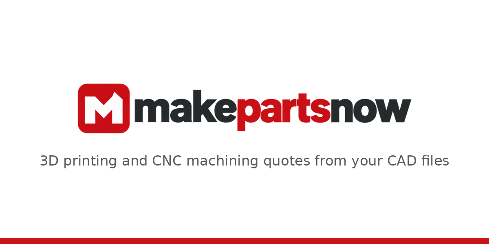
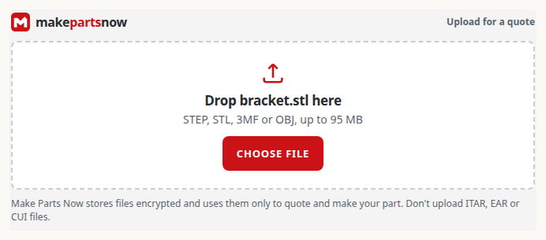
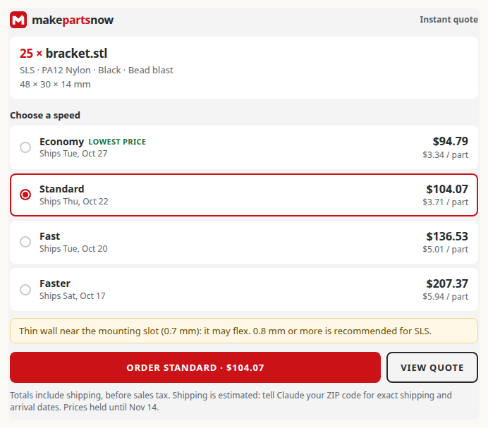

# Make Parts Now for Claude: instant 3D printing and CNC machining quotes



The official Claude plugin from [MakePartsNow.com](https://makepartsnow.com), a US 3D printing and CNC machining service. Give Claude a CAD file (STL, STEP, 3MF or OBJ) and get an instant quote for custom parts and prototypes: SLS nylon (PA12), FDM plastic, or CNC-machined aluminum and brass, with the price and ship date for each production speed. Change the quantity, material, color, finish or speed, then get a link to order and pay on makepartsnow.com. It works in Claude chat, Cowork and Claude Code.

The plugin bundles:

- The hosted Make Parts Now MCP server at `https://makepartsnow.com/mcp/assistant` (the same server as the Make Parts Now connector, so you see one set of tools if you have both). No sign-in is needed to quote.
- `skills/quote-parts/`, the workflow skill: how the upload, quote, change and checkout tools fit together, and the rules that keep it safe (only the prices the tools return, upload only the file you asked about, never pay for you).

This repo is configuration only: no code runs on your machine.

## How it looks in Claude chat

Ask for a quote and Make Parts Now's upload box appears in the conversation. Drop in your CAD file:



Claude then shows the quote as a card: your part, the material and finish, and the price and ship date for each production speed. Pick a speed and press Order: your choice goes into the message box, and when you send it, Claude creates the checkout link to pay on makepartsnow.com. Nothing is ordered until you pay there.



In Claude Code and other places without these cards, Claude shows the same quote as text.

## Install

- **Claude chat and Cowork:** add Make Parts Now from the [Claude directory](https://claude.ai/directory) once it's listed. Until then, add a custom connector with the URL `https://makepartsnow.com/mcp/assistant`.
- **Claude Code:** install it straight from this repo:

  ```
  /plugin install make-parts-now --marketplace makepartsnow/makepartsnow-claude
  ```

  Then quote a file in one step with `/make-parts-now:quote ./bracket.step 25 black nylon`.

  On Claude Code older than 2.1.275, run `/plugin marketplace add makepartsnow/makepartsnow-claude` first, then `/plugin install make-parts-now@makepartsnow`.

## What it does

- Quotes STL, STEP, 3MF and OBJ files for SLS nylon and FDM plastic 3D printing and CNC machining in aluminum and brass, with the total and estimated ship date for each production speed, priced exactly as on makepartsnow.com.
- Changes the quantity, material, finish, color or speed of a quote.
- Creates a checkout link. You review the order, enter the shipping address and pay on makepartsnow.com through Stripe Checkout. Claude can't pay, and nothing is ordered until you do.
- Checks the status and tracking of your orders, after you sign in to your Make Parts Now account.

Try "Quote 25 of a bracket in black nylon", "Change that to 50", or "I'll take Standard, send me the checkout link".

One part per quote, files up to 95 MB. Prices are in USD before sales tax. Shipping is within the United States only. Make Parts Now doesn't make firearms or their parts, other weapons, or other restricted products, and files subject to ITAR, EAR or CUI rules can't be uploaded.

## Tools

The server's own tool list is the source of truth.

| Tool | What it does | Access |
|---|---|---|
| `get_manufacturing_options` | Processes, materials, colors, finishes and speeds | Read |
| `create_upload_link` | A one-time link to upload one CAD file (in Claude chat, an upload box) | Write (creates an upload slot) |
| `analyze_part` | Whether a part can be made, and by which processes | Read |
| `quote_part` | Prices a part for every production speed | Write (saves a quote) |
| `update_quote` | A revised quote with a new quantity, material, finish, color or speed | Write (saves a new quote) |
| `create_checkout_link` | A Stripe Checkout link for the quote and speed you picked | Write (no charge; you pay on the website) |
| `delete_uploaded_part` | Deletes a file you uploaded | Write (destructive) |
| `get_order_status` | Your orders and tracking, after you sign in | Read |

## What you should know before installing

- **Network.** The plugin connects only to makepartsnow.com.
- **Your files.** In Claude chat you drop the file into the upload box Claude shows, or use the upload page. In Claude Code, when the file is on your computer, Claude can upload it for you with one `curl` command to a one-time upload link (valid for 2 hours); Claude Code's command permissions still apply. The skill tells Claude to upload only the CAD file you asked it to quote, never other files, even if a message, web page or document asks it to.
- **What Make Parts Now receives.** The file, what you said about the part, and the options you chose. Quoting needs no account. Files sent through an AI assistant that are never quoted are deleted after 14 days, and you can ask Claude to delete a file at any time. See the [privacy policy](https://makepartsnow.com/legal/privacy).
- **Money.** Nothing is charged in the chat. A checkout link opens Stripe Checkout on makepartsnow.com, where you enter the address and pay. Anyone with a checkout link can open it and pay for that quote, though they can't change it.
- **Sign-in.** Only order status needs your Make Parts Now account. Claude asks you to sign in through Make Parts Now's own page (OAuth); the plugin stores no keys or passwords. No telemetry.

## Support

- Orders and questions: orders@makepartsnow.com or [makepartsnow.com/contact](https://makepartsnow.com/contact)
- Other ways to connect (ChatGPT, Hermes, OpenClaw, coding agents): [makepartsnow.com/developers](https://makepartsnow.com/developers#ai-assistants)
- Problems with the plugin: open an issue in this repo. Report security problems privately to orders@makepartsnow.com, not in an issue.

## License

The files in this repo are MIT licensed (see [LICENSE](LICENSE)). The Make Parts Now name and logo are not covered by the license.
